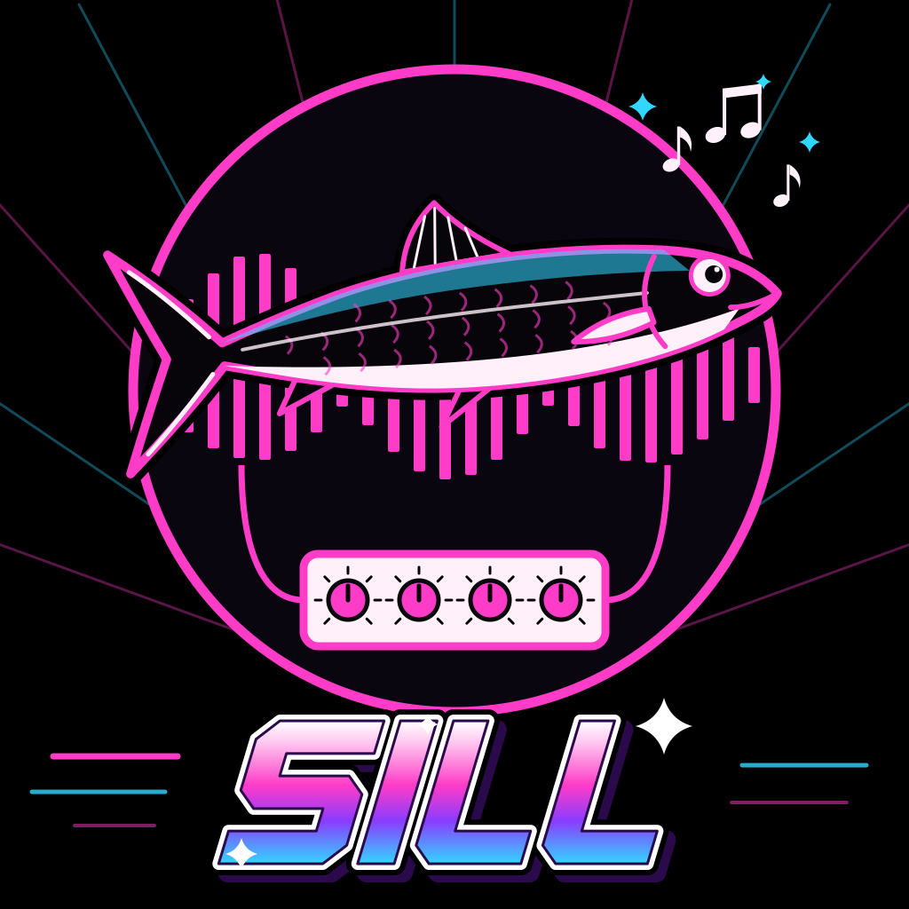
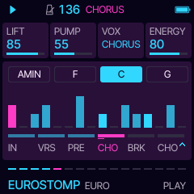
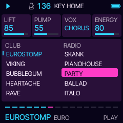
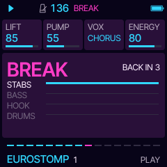
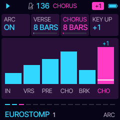

# Sill

**Generative 90s eurodance for the M-VAVE FM-1, pickled in 1995.** Press PLAY and Sill writes a song and plays
it: offbeat basses, piano and supersaw stabs, a hook for the chorus, a crowd that shouts HEY, and a key change for
the last chorus. Ten styles on two sides, CLUB and RADIO. You steer it with four knobs, break it down, push the key
up, and play the hook yourself on the keys. Built on Daurade, [Tuna](https://github.com/delirioux/tuna) and
[Felucca](docs/FELUCCA.md).

> **Version 0.4.** Runs on the FM-1. Built with no warranty. Felucca's or Tuna's installer, or the official V15,
> takes the FM-1 back.

## Install

Open **[delirioux.github.io/sill](https://delirioux.github.io/sill/)** in Chrome or Edge on a computer, connect
the FM-1 with a USB data cable and press Install (allow MIDI when the browser asks). The page checks the package in
the browser and writes it over USB-MIDI, as Felucca's installer does. Sill keeps its settings and its eight sets
in Felucca's first two song slots: back up anything you made in Felucca first.

Or **try it in the browser** first: [delirioux.github.io/sill/try](https://delirioux.github.io/sill/try/) runs
the same firmware, compiled to WebAssembly on Felucca's browser emulator (Chrome, Edge or Firefox; the computer
keyboard plays the keys). The test build from `dev` plays at
[delirioux.github.io/sill/dev/try](https://delirioux.github.io/sill/dev/try/).

Test builds: the newest from `dev` installs from [delirioux.github.io/sill/dev](https://delirioux.github.io/sill/dev/);
every run also leaves its package in the artifact `sill-firmware`. From a terminal: `python3 tools/fm1_install.py sill-X.Y.fwsc`.

## The four knobs

| | |
| --- | --- |
| **LIFT** | The low-pass on the stabs (and the hook in some styles). The knob is its ceiling; the intro and the pre-chorus open the filter up to it, the break holds it lower. |
| **PUMP** | How deep the whole mix ducks on each kick and breathes back. The drums never duck. |
| **VOX** | The crowd: OFF, shouting in the CHORUS, or in ALL of the song (the verse too). |
| **ENERGY** | Density and drive together: from a bare groove to sixteenth hats, pickup kicks and extra stabs. |

## Ten styles

| CLUB | | RADIO | |
| --- | --- | --- | --- |
| **EUROSTOMP** · 136 | offbeat bass, supersaw stabs and hook, HEY | **SKANK** · 95 | reggae offbeat chops, dub bass, a flute hook |
| **VIKING** · 138 | harmonic minor, brass stabs, octave bass, WHOA | **PIANOHOUSE** · 125 | offbeat piano with sevenths over a warm pad, open hats |
| **BUBBLEGUM** · 130 | major key, bouncy plucks, a bell hook, HO | **PARTY** · 140 | bouncing bass, brass, every shout there is |
| **HEARTACHE** · 134 | piano over a happy beat, the hook sung OOH | **BALLAD** · 100 | the slow radio edit: pads, fretless, piano |
| **RAVE** · 140 | hoover stabs, rolling bass, 16th hats | **ITALO** · 120 | strings, octave bass, an arpeggio sung OOH |

A style brings its own tempo, sounds, key, chord loop, groove, drums, shouts and space; your MIX, ARC and MENU
stay. A new style or song comes in on the next bar line, so a song never changes mid-bar. ALGORITHM picks another
song in the same style: a new chord loop, bass line and hook, the same each time you come back to its number.

With **ARC** on (the default) a song has a form: an INTRO that brings the parts in one by one, a VERSE without the
hook (room for the rap that is not there), a PRE-chorus of held chords, a snare roll and the filter lifting, the
CHORUS with everything and the crowd, a BREAK of chords and hook alone with a roll back in, and the last CHORUS a
semitone or two higher (KEY UP). Then round again from the verse, with a new hook.

## The controls

| | |
| --- | --- |
| SELECT | tempo |
| MASTER | volume |
| PRESETS | the style (the list shows while turning; it comes in on the next bar) |
| ALGORITHM | a new song in the same style (on the next bar) |
| KNOB 1-4 | the four cards on the screen (PLAY: LIFT PUMP VOX ENERGY) |
| PLAY | start (with the intro) / stop |
| REC | BREAK: tapped, everything but the stabs drops out for three bars, a snare roll comes in the fourth, and the chorus slams back on the bar line; held, the break stays until you let go, then the roll |
| SEQ | KEY UP: the song a semitone up from the next bar; again +2, +3, then home |
| keys | the hook, live, snapped to the scale: whatever you press is in key. The keys only ever play music |
| OCT- / OCT+ | the keys' octave |
| HOME | PLAY; hold it: MENU (COLOR, LOOK) |
| FX | SOUND (the four parts' sounds), again: TONE (RESO DRIVE DETUNE CRUSH) |
| LFO | VOX (VOWELS SHIFT CHANT GLIDE) |
| SCL | KEY (KEY SCALE CHORDS BARS) |
| ARP | GROOVE (SWING HATS BASS FILLS) |
| EDIT | DRUMS (KIT KICK CLAP CRASH) |
| GLO | MIX (the four levels), again: SPACE (REVERB DELAY TIME WIDTH) |
| ENV | ARC (ARC VERSE CHORUS KEY UP), again: HOOK (SPEED RANGE GATE REPEAT; SPEED PAD: a pad on the chords instead of a tune) |
| SAVE | SETS: eight sets on the knobs (SET, LOAD and STORE turned right, CLEAR turned right three times) |

The keys' LEDs glow on the notes of the chord playing: the ones that fit right now. MIDI out: STABS on channel 1,
BASS on 2, HOOK on 3, the drums on 10 (General MIDI notes; the shouts are not sent). The settings and the sets save
themselves while stopped. [docs/MANUAL.md](docs/MANUAL.md) goes through every page.

## The sound

Four parts on Felucca's engines, sixteen sounds each, evened out so a new sound does not jump out of the mix:

| Part | Sounds |
| --- | --- |
| STABS | PIANO, ORGAN, SUPER, STRINGS, BRASS, PLUCK, HOOVER, ORCH, BELLS, PAD, HOUSE (organ), DEEP (house chord), HORNS, CHOIR, VIOLINS, TRANCE |
| BASS | FM BASS, SQUARE, SUB, FAT, ACID, REESE, SLAP, SLIDE (fretless), OCTAVE, WOW, ORGAN, SYNTH, SINE, TRANCE, DX, GROWL |
| HOOK | SUPER, SAW, PLUCK, BELL, PIANO, HOOVER, OOH, SYNC, FLUTE, PAD, REEDS (accordion), ANTHEM, CHOIR, WHISTLE, TRANCE, ROBOT |

Each style has four sounds a part to choose from: song 1 plays its own, every other song (ALGORITHM) picks from
those four, so the songs of one style do not all sound alike. A card turned by hand holds until the next song.
PIANO on STABS turns any style into offbeat piano chords, the 90s way. The SUPER hook is two detuned saws on every
free voice (UNISON); the PIANO is six notes of a Kawai grand (VCSL, CC0) made bright and hard for the club; the ORCH
hit is an FM patch of Sill's own; OOH, CHOIR and ROBOT are Felucca's VOICE engine, a formant synthesizer, singing between two vowels (the VOX page).

The drums are Sill's own: seven one-shots (two kicks, snare, clap, closed and open hat, crash) and the crowd's
three shouts (HEY, HO, WHOA), all synthesized by [`tools/si_drums.py`](tools/si_drums.py). The shouts are eight
made-up voices through formant filters, no recording of anyone. Everything is stored at 44.1 kHz and dedicated to
the public domain (CC0). The KIT card: EURO (these, with the crowd), SESSION or MACHINE (Felucca's DRUM engine,
without the crowd).

Colours: LASER, Sill's own (night purple, laser cyan, hot magenta), and all of Felucca's.

## Building

As Daurade and Tuna (see [BUILDING.md](BUILDING.md)), with `FELUCCA_SILL=1 ./build.sh`. GitHub Actions builds
every push to `main` and `dev`, and publishes the site from either: main's release at the root, dev's test build
under `dev/` (`web/si_make_site.py`; the repository needs Settings > Pages > Source: GitHub Actions, and `dev`
allowed in the `github-pages` environment). `sh tests/si_tests.sh` runs the host tests;
`sh tests/si_felucca.sh OUTDIR` renders a song through Felucca's engines to a WAV; `sh tests/si_audition.sh`
measures every sound's loudness; `web/emu/si_build.sh` builds the browser version (Emscripten, or clang with a WASI
sysroot). Design notes and the plan: [docs/DEVELOPMENT.md](docs/DEVELOPMENT.md).

## Credits and licence

GPL-3.0-only. Sill by delirioux and Claude; a fork of Daurade, Flyfish and Tuna (delirioux), forks of
Felucca by Leo Kuroshita, Hügelton Instruments; the web installer is Felucca's. The drum and shout samples are CC0.
See [CREDITS.md](CREDITS.md) and [LICENSING.md](LICENSING.md).
