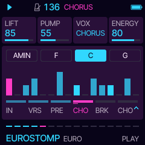
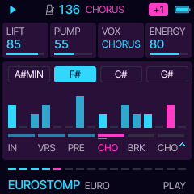

# Sill manual

Sill 0.1. Every page, every card. Four parts play: **STABS** (the chords), **BASS**, **HOOK** (the chorus's tune,
and whatever you play on the keys) and **DRUMS** (with the crowd's shouts). Knob 1 to 4 turn the four cards on the
screen. A page's button pressed again goes to its second page where it has one.

## Playing

PLAY starts with the intro (with ARC on) and stops. PRESETS opens the list of the ten styles while you turn; the
chosen one comes in on the next bar line, NEXT in the header until it does. ALGORITHM picks a new song in the same
style on the next bar: its number seeds the chord loop, the bass line and the hook, so a song always comes back the
same. SELECT is the tempo, MASTER the volume.

The header shows the section playing (INTRO, VERSE, PRE, CHORUS, BREAK) and, on the right, a badge: the key up
(+1, +2, +3) or HELD while a break is held. The footer's sixteen dashes are the way through the section.

**REC is BREAK.** Tap it: everything but the stabs drops out, the stabs hold their chords for three bars, a snare
roll comes in the fourth and the chorus slams back on the bar line. Hold it: the break stays until you let go, then
the roll, then the chorus.

**SEQ is KEY UP.** The whole song a semitone up from the next bar line; again for +2, +3, and once more to go home.
A new style or song starts at home again. With ARC on, the last chorus goes up on its own as well (ARC > KEY UP).

**The keys** play the HOOK, live, snapped to the scale (and to the key up): any key you press is in key. While you
hold one, the written hook makes way. OCT- and OCT+ move the keys' octave. The keys' LEDs glow on the notes of the
chord playing. The keys never change a setting.

## The form

With ARC on, a song goes:

| Section | Bars | What plays |
| --- | --- | --- |
| **INTRO** | 8 | The kick alone, then the hats and the bass (bar 3), then the stabs (bar 5); the filter opening. |
| **VERSE** | 8 or 16 | No hook: the stabs every other bar, the hats a little lighter. With VOX ALL the crowd shouts here too. |
| **PRE** | 4 | The stabs held a bar each, louder each bar; a snare roll from quarters to sixteenths; the filter lifting; the last beat the roll alone. |
| **CHORUS** | 8 or 16 | Everything: the hook, the crowd, a crash to start it. |
| **BREAK** | 8 | The chords held and the hook, softer; no bass, no drums; the last two bars a roll back in. |
| **CHORUS** | 8 or 16 | Again, KEY UP's semitones higher. |

Then round again from the VERSE, with a new hook and the key back home. With ARC off the chorus plays on and on.

## The pages

| Page (button) | Cards |
| --- | --- |
| **PLAY** (HOME) | **LIFT** the filter's ceiling on the lifted parts (the stabs, and the hook in some styles). **PUMP** how deep the mix ducks on each kick. **VOX** the crowd: OFF, in the CHORUS, or in ALL the song. **ENERGY** density and drive: sixteenth hats, pickup kicks, extra stabs. The panel: the chord loop, the bar as it plays (a column a sixteenth, as tall as the parts that sounded), and the form with the section playing. |
| **SOUND** (FX) | **STABS**, **BASS**, **HOOK**: ten sounds each. **DRUMS**: the kit, EURO (Sill's own one-shots and the crowd), SESSION or MACHINE (Felucca's DRUM engine, no crowd). |
| **TONE** (FX again) | **RESO** the lifted filter's resonance. **DRIVE** saturation. **DETUNE** the chorus that thickens the stabs and the hook. **CRUSH** bits and rate, down from clean. |
| **VOX** (LFO) | **VOWELS** the two vowels the OOH sound sings between (OO-AH, AH-EE, OH-AH, OO-EE, AH-OH). **SHIFT** its formants, -12 to +12. **CHANT** what the crowd shouts: HEY, HO, WHOA or a MIX. **GLIDE** between the OOH's notes. The panel shows where the shouts fall in two bars. |
| **KEY** (SCL) | **KEY** the root. **SCALE** MINOR, MAJOR, DORIAN, HARMONIC MINOR. **CHORDS** one of twelve chord loops. **BARS** a chord lasts 1, 2 or 4 bars. |
| **GROOVE** (ARP) | **SWING** on the sixteenths. **HATS** 8THS, 16THS, OFFBEAT or OPEN. **BASS** the bass line: OFFBEAT, OCTAVE, ROLLING, REGGAE, LONG or BOUNCE. **FILLS** every 8, 4 or 2 bars, or none. |
| **DRUMS** (EDIT) | **KIT** as on SOUND. **KICK** PUNCH or ROUND. **CLAP** the backbeat: CLAP, SNARE or BOTH. **CRASH** OFF, on each SECTION, or every 8 BARS in the chorus too. |
| **MIX** (GLO) | the four parts' levels. |
| **SPACE** (GLO again) | **REVERB**, **DELAY**, **TIME** the delay in 1/16, 1/8, 3/16 or 1/4, **WIDTH** the stereo spread. |
| **ARC** (ENV) | **ARC** on: the song has its form; off: the chorus on and on. **VERSE** 8 or 16 bars. **CHORUS** 8 or 16 bars. **KEY UP** the last chorus OFF, +1 or +2. |
| **HOOK** (ENV again) | **SPEED** SLOW (long sung notes), MID (eighths) or FAST (the syncopated sixteenth riff). **RANGE** 1 or 2 octaves. **GATE** how long each note holds. **REPEAT** the hook's phrase: 1, 2 or 4 bars, a motif and its answer. The panel draws the hook, the note playing lit (ITALO: its arpeggio). |
| **SETS** (SAVE) | Eight sets: the whole song, style and all. **SET** picks one, **LOAD** and **STORE** turned right do it, **CLEAR** turned right three times empties it. |
| **MENU** (hold HOME) | **COLOR** the palette: LASER by default, and Felucca's. **LOOK** FLAT or LINE. |

A style sets its tempo, sounds, key, chord loop, groove, drums, shouts, space and hook; MIX, ARC and MENU stay
yours.

## MIDI out

STABS on channel 1, BASS on 2, HOOK (and the keys) on 3, the drums on 10 with General MIDI notes. The crowd's
shouts have no General MIDI drum and are not sent.

## Saving

The settings save themselves two seconds after the last change while stopped, never while playing (writing the
flash would stall the audio). They live in Felucca's first song slot, the sets in its second.
